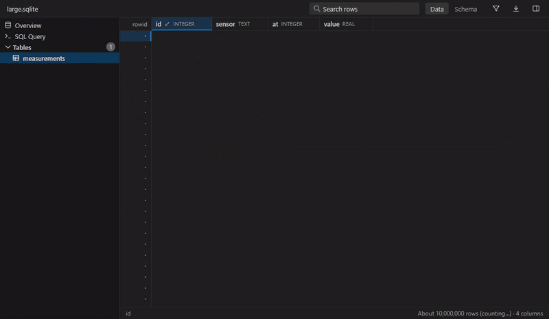
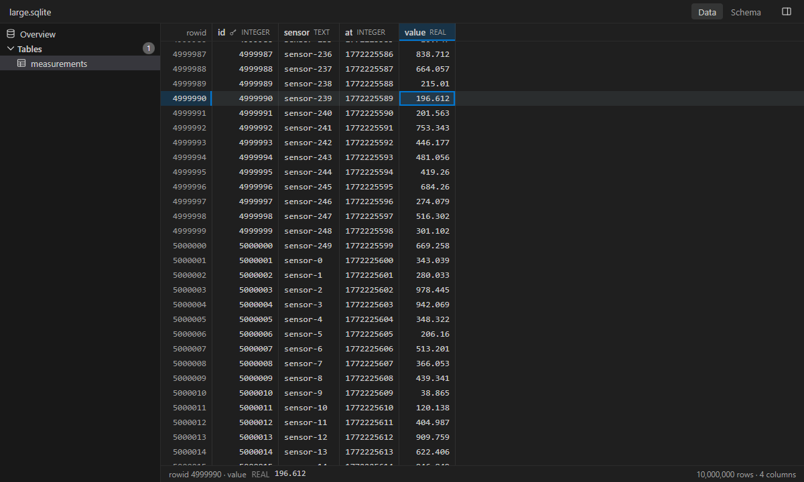
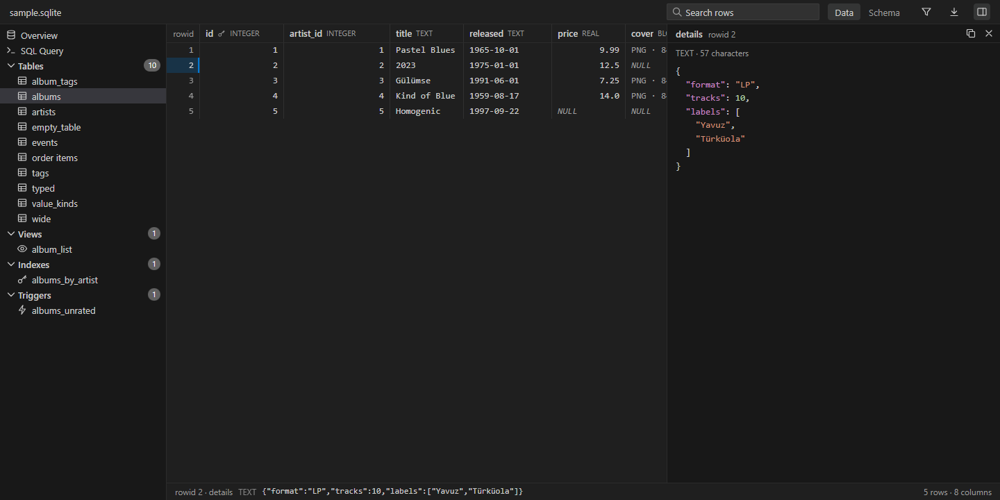
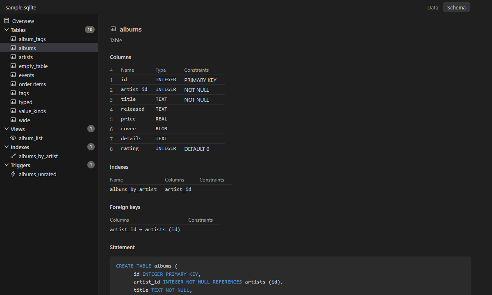
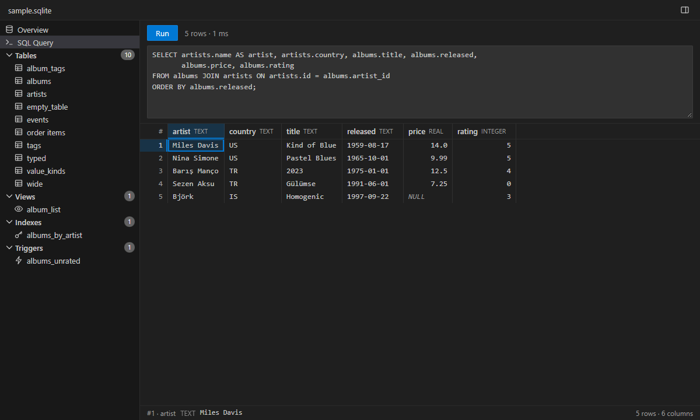
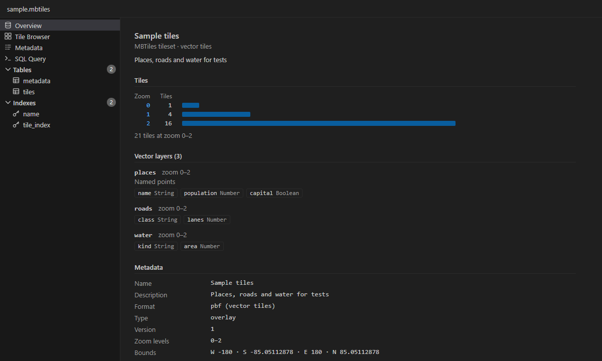
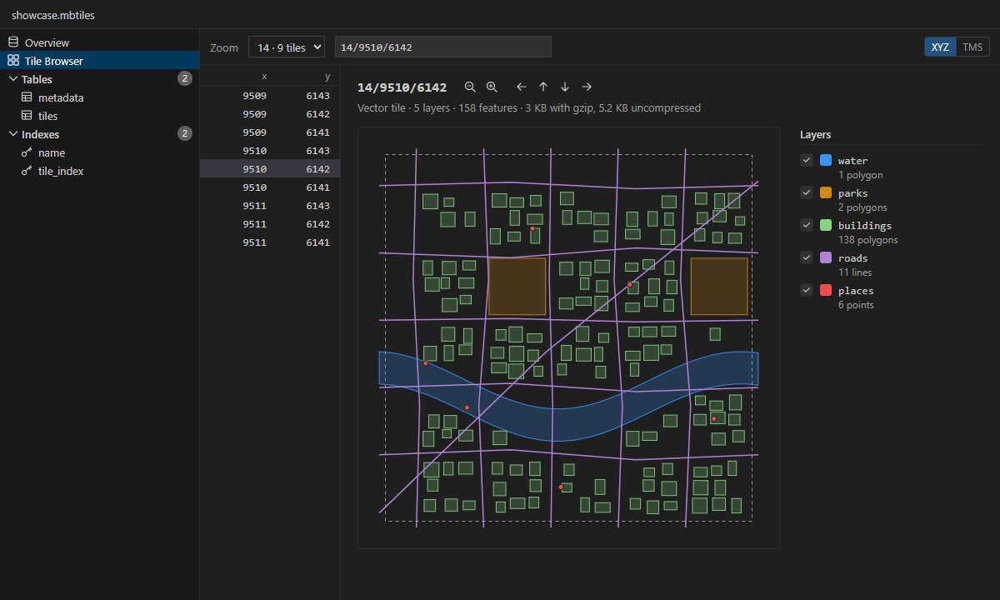
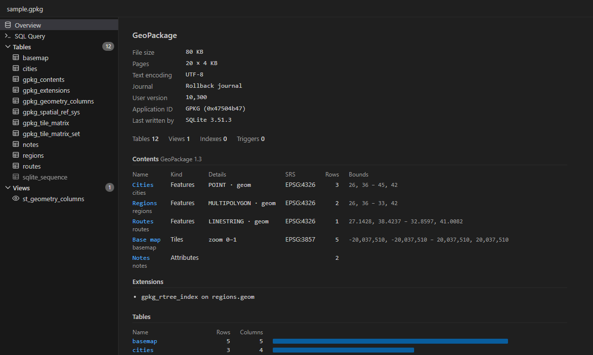

# Nightlite

**Browse SQLite databases, MBTiles and GeoPackages in VS Code, even when they're tens of
gigabytes.**

Nightlite is a fast, dark-first viewer for SQLite files: app databases (`.sqlite`,
`.sqlite3`, `.db`, `.db3`), MBTiles tilesets (`.mbtiles`) and GeoPackages (`.gpkg`). It reads only
the rows on screen, so a table of ten million rows scrolls as smoothly as one of ten, and a 24 GB
tileset opens at once.

## Why Nightlite

- **Built for big files.** Nothing is loaded whole. Any row of any table is a click or a key
  away, rows are counted in the background, and memory stays flat however far you scroll.
- **Made for MBTiles.** A tileset opens on a summary: tiles by zoom level, vector layers and their
  fields, and its metadata checked against the MBTiles spec. The tile browser draws any tile,
  vector or raster, at any zoom level of any size.
- **Exact.** Values show as SQLite stores them: integers beyond 2^53 keep every digit, a `REAL`
  keeps its decimal point, `NULL` stands apart from text, and BLOBs say what they hold.
- **Dark-first.** Follows your VS Code theme, including high contrast.
- **Read-only and private.** Databases are opened read-only and nothing is written next to them,
  not even a `-wal` or `-shm` file. The one exception is an MBTiles tileset's metadata, written
  only when you save your changes to it. No telemetry, no network access.

## Features

### Databases

- An overview of the database: its tables with their rows and columns, drawn to scale, and how
  many views, indexes and triggers it holds
- A sidebar of tables, views, indexes and triggers; **Go to Table…**
  (<kbd>Ctrl</kbd>+<kbd>Shift</kbd>+<kbd>O</kbd>) finds one as you type
- A grid that scrolls through millions of rows and jumps anywhere at once, with rowids, column
  types and primary keys in view
- Sort by any column from its header or the context menu, search every column for some text
  (<kbd>Ctrl</kbd>+<kbd>F</kbd>), and filter column by column: `blue`, `>9`, `=Ankara`,
  `<>0`, `=NULL`. Sorting ten million rows takes seconds, and every one of them is then a
  click away
- Select cells as in a spreadsheet, with the mouse or the keyboard; the status bar shows the
  selected cell's storage class and value
- <kbd>Ctrl</kbd>+<kbd>C</kbd> copies the selection with full values, even where the grid cuts them
  short: one cell as it is, more as tab-separated text that spreadsheets paste into columns.
  **Copy as Markdown Table**, in the context menu, copies it as a table for a README or an issue
- **Export Rows…** writes a table's rows as shown, sorted and filtered, or every row of a query,
  to a CSV or JSON file, with values whole: ten million rows take about fifteen seconds
- Cell details beside the grid: JSON indented and colored, long text in full, BLOBs as the image
  or text they hold, or as a hex dump
- The schema of each table: columns, indexes and foreign keys, and the statement that created it
- When another program changes the file, the view reloads and keeps your place

- **SQL Query**: run a `SELECT` (<kbd>Ctrl</kbd>+<kbd>Enter</kbd>) and page through its rows in
  the same grid, with the same copying and cell details. Statements that would write, and
  `ATTACH` or `VACUUM INTO`, are turned down; the file is never changed. A slow query can be
  stopped (<kbd>Escape</kbd>) and shows the rows read so far

### MBTiles

- The tileset's name, description and kind (vector or raster tiles) at the top
- Tiles by zoom level, counted in the background and drawn to scale
- Vector layers with their fields and types, zoom levels and, where the tileset records them,
  feature counts and geometry
- The metadata as the MBTiles 1.3 spec reads it, with missing or unreadable keys, and zoom levels
  the tiles contradict, pointed out
- Deduplicated tilesets, where `tiles` is a view over shared images, are recognized

- A tile browser: pick a zoom level, go to a tile by its z/x/y or a pasted tile URL, or pick one
  from the zoom level's tiles, millions of them included
- Vector tiles drawn layer by layer, each layer's features counted by geometry type; show or
  hide layers as you go
- Point at a feature to see its attributes with their types, 64-bit integers to the last digit;
  click to keep them in view, or step through the features with <kbd>[</kbd> and <kbd>]</kbd>
- Raster tiles (PNG, JPEG, WebP) shown as images, and every tile's size, stored and uncompressed
- **Metadata** as a form: change, add or remove keys, checked against the MBTiles 1.3 spec as you
  type, and zoom levels against the tiles. Changes are marked until you save (<kbd>Ctrl</kbd>+<kbd>S</kbd>),
  <kbd>Ctrl</kbd>+<kbd>Z</kbd> undoes them, and nothing is written before you save
- **Save Tile…** writes the tile shown to a file you pick: images as they are, vector tiles as
  plain `.pbf`, or gzip-compressed when the name ends in `.gz`
- Arrow keys move to the neighboring tiles, <kbd>+</kbd> and <kbd>−</kbd> between zoom levels;
  rows numbered as in tile URLs (XYZ) or as MBTiles stores them (TMS)

### GeoPackage

- The GeoPackage's contents on its overview: each feature, tile and attribute table with its
  geometry type or zoom levels, its spatial reference system, rows and bounds, and the
  extensions in use
- Geometries say what they are in the grid (`MULTIPOLYGON`, `POINT Z`), and the cell details
  draw them, or show them as WKT, with their SRS and number of points
- Tiles in a tile table show as images in the cell details

### Everywhere

- Dark, light and high contrast themes
- Keyboard and screen reader support
- English and Turkish

## Getting started

1. Install **Nightlite** from the
   [Visual Studio Marketplace](https://marketplace.visualstudio.com/items?itemName=MBKDevStudio.nightlite)
   or, in VSCodium and other editors that use it,
   [Open VSX](https://open-vsx.org/extension/MBKDevStudio/nightlite). Or search for "Nightlite"
   in the Extensions view.
2. Open a `.sqlite`, `.sqlite3`, `.db`, `.db3`, `.mbtiles` or `.gpkg` file. Nightlite is the
   default viewer for these files.

Nightlite opens any SQLite file, whatever its name: right-click it and choose
**Open With… › Nightlite**. A file that turns out not to be a SQLite database offers
**Reopen With…** to pick another editor.

## Keyboard shortcuts

| Action                                | Windows / Linux                                                                         |
| ------------------------------------- | --------------------------------------------------------------------------------------- |
| Go to a table, view, index or trigger | <kbd>Ctrl</kbd>+<kbd>Shift</kbd>+<kbd>O</kbd>                                           |
| Move the selected cell                | Arrow keys, <kbd>Page Up</kbd> / <kbd>Page Down</kbd>, <kbd>Home</kbd> / <kbd>End</kbd> |
| First or last row or column           | <kbd>Ctrl</kbd>+arrow keys, <kbd>Ctrl</kbd>+<kbd>Home</kbd> / <kbd>End</kbd>            |
| Extend the selection                  | <kbd>Shift</kbd> with any of the above                                                  |
| Select all                            | <kbd>Ctrl</kbd>+<kbd>A</kbd>                                                            |
| Copy                                  | <kbd>Ctrl</kbd>+<kbd>C</kbd>                                                            |
| Search rows                           | <kbd>Ctrl</kbd>+<kbd>F</kbd>                                                            |
| Run a query                           | <kbd>Ctrl</kbd>+<kbd>Enter</kbd> (<kbd>Escape</kbd> stops it)                           |
| Show the cell in full                 | <kbd>Enter</kbd> (<kbd>Escape</kbd> goes back to the grid)                              |
| Move to a neighboring tile            | Arrow keys, in the tile browser                                                         |
| Zoom in or out a level                | <kbd>+</kbd> / <kbd>−</kbd>, in the tile browser                                        |
| Step through a tile's features        | <kbd>[</kbd> / <kbd>]</kbd> (<kbd>Escape</kbd> lets go)                                 |

On macOS, use <kbd>Cmd</kbd> in place of <kbd>Ctrl</kbd>.

## Limitations

- Nightlite changes nothing but an MBTiles tileset's metadata, and that only when you save. Rows,
  tiles and schemas are read-only.
- **Save As** isn't available for a tileset's metadata: saving writes it into the file itself.
- Queries run only statements that read. A query's results hold up to 100,000 rows in the grid
  (Export Rows… writes all of them), and a table sorted or filtered up to ten million.
- A copy holds up to a million rows or 16 MB.
- GeoPackage tile tables show their tiles one at a time, in the cell details; there's no map.
- Files have to be on a disk VS Code's extension host can reach, locally or in a remote window;
  virtual file systems aren't supported.
- Encrypted databases (SQLCipher) can't be opened.
- Requires VS Code 1.103 or later.

## Contributing

Bug reports and ideas are welcome in [issues](https://github.com/mbKalkan/nightlite/issues). See
[CONTRIBUTING.md](CONTRIBUTING.md) to build and test the extension.

## License

[MIT](LICENSE). Third-party components and their licenses are listed in
[THIRD_PARTY_NOTICES.md](THIRD_PARTY_NOTICES.md).
